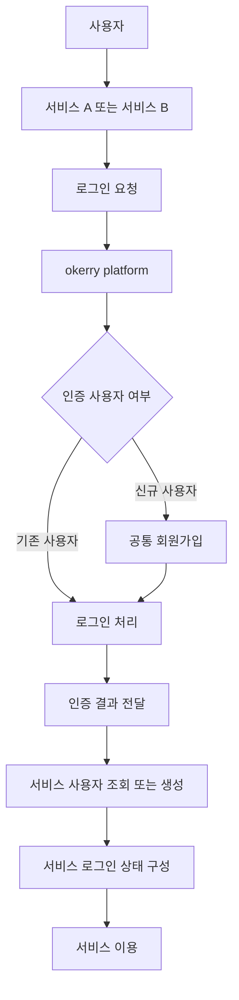

# okerry platform

`okerry platform`은 여러 사이드 프로젝트에서 공통으로 사용할 수 있는 인증 및 인가 시스템입니다.

예를 들어 `서비스 A`, `서비스 B`와 같은 여러 사이드 프로젝트가 있다고 가정했을 때, 각 서비스는 자체 로그인 화면을 제공하지 않고 `okerry platform`에서 제공하는 로그인 및 회원가입 화면을 사용합니다.

`okerry platform`은 Spring Security, OAuth2, OIDC, JWT 기반으로 로그인, 회원가입, 토큰 발급 및 토큰 갱신 기능을 제공하는 중앙 인증 서버입니다.

각 서비스는 `okerry platform`을 인증 서버로 사용하며, 인증 완료 후 전달받은 인증 결과를 기반으로 서비스 내부의 로그인 상태를 구성합니다.

## 기술 스택

| 구분 | 기술 |
| --- | --- |
| Language | Java 21 |
| Framework | Spring Boot 4.1.0 |
| Build Tool | Gradle |
| Web | Spring Web MVC, Spring Web Services |
| Security | Spring Security, OAuth2 Client |
| View | Thymeleaf, Thymeleaf Spring Security |
| Persistence | Spring Data JPA, Spring JDBC |
| Database | PostgreSQL (Neon) |
| Validation | Spring Validation |
| Utility | Lombok |
| Test | JUnit 5, Spring Boot Test |


## Neon 로컬 실행

Neon 연결 설정은 Git에서 제외된 `src/main/resources/application-neon.properties`에 두고, 비밀번호는 파일에 작성하지 않습니다.
실행 환경에 `NEON_DATABASE_PASSWORD`를 설정한 뒤 `neon` 프로필로 실행합니다.

```text
SPRING_PROFILES_ACTIVE=neon
NEON_DATABASE_PASSWORD=로컬 환경변수로 설정
SMTP_GMAIL_APP_PASSWORD=Gmail App Password를 로컬 환경변수로 설정
```

애플리케이션은 pooled endpoint와 SSL 연결을 사용하고, `spring.jpa.hibernate.ddl-auto=validate`로 기존 스키마를 검증만 합니다.


## 서비스 흐름



## 인증 구조 개념

```text
서비스
  - 사용자에게 서비스 기능 제공
  - 인증이 필요하면 okerry platform으로 인증 요청
  - 인증 완료 후 서비스에 필요한 사용자 정보를 별도로 관리

okerry platform
  - 공통 인증 사용자 관리
  - 로그인 및 회원가입 처리
  - 인증 결과를 서비스에 전달
  - Spring Security/OAuth2 기반 인증 구조로 확장

Database
  - 공통 사용자 정보
  - 서비스 연동 정보
  - 인증 관련 데이터 저장
```
